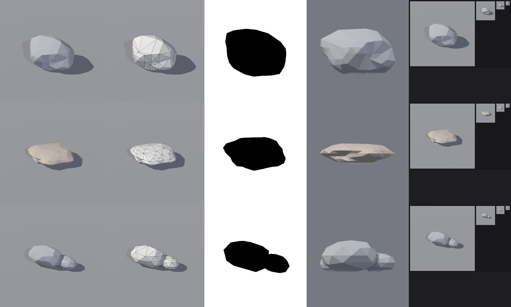
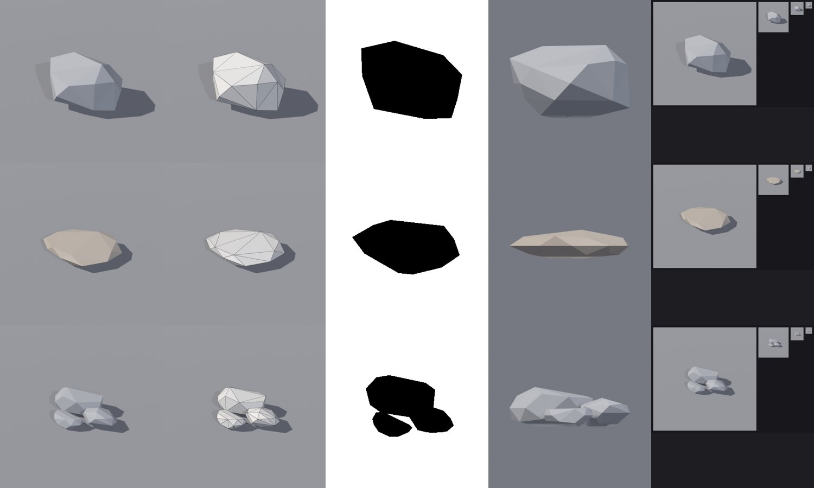

# BL-EX-01 — Stylized rocks

**Status: executed** (bpy 5.2.3, 2026-10-24).

## Acceptance criteria
Three distinct silhouettes (boulder / slab / cluster); visibly faceted planes; a flat base that sits on the ground; ≤ 600 tris each; one material each.

## Method
`rbx_shapes.rock()`: subdivided icosphere → two-octave noise displacement → per-axis stretch → limited dissolve (`chunk` = angle) → triangulate leftovers → sink 12% into the ground → **bisect at z=0 and fill the cut**, so the base is flat and closed.

## v1

- Boulder: 204 tris; **the silhouette is an even oval/egg made of many small facets** and reads as a "low-poly sphere".
- Slab: 232 tris; good contrast shape.
- Cluster: 250 tris; **the third pebble is hidden behind the first** and the visible two sit in a line.
- QC: all pass ([boulder](../../Assets/Original/Blender/BL-EX-01-Stylized-Rocks/rock_boulder-v1-qc.json) · [slab](../../Assets/Original/Blender/BL-EX-01-Stylized-Rocks/rock_slab-v1-qc.json) · [cluster](../../Assets/Original/Blender/BL-EX-01-Stylized-Rocks/rock_cluster-v1-qc.json)).

## v2: changes
`detail` 2→1 and `chunk` 0.35→0.6 for fewer, bigger planes; cluster rearranged as a triangle of big/medium/small.

- Boulder: **56 tris**, angular silhouette with large planes. Slab 66 tris. Cluster 164 tris, all three sizes visible.
- QC: all pass ([boulder](../../Assets/Original/Blender/BL-EX-01-Stylized-Rocks/rock_boulder-v2-qc.json) · [slab](../../Assets/Original/Blender/BL-EX-01-Stylized-Rocks/rock_slab-v2-qc.json) · [cluster](../../Assets/Original/Blender/BL-EX-01-Stylized-Rocks/rock_cluster-v2-qc.json)). Exports re-import at identical sizes ([round trip](../../Assets/Original/Blender/BL-EX-01-Stylized-Rocks/props-roundtrip-v2.json)).
- Exports: [boulder FBX](../../Assets/Original/Blender/BL-EX-01-Stylized-Rocks/export/rock_boulder_v2.fbx) · [GLB](../../Assets/Original/Blender/BL-EX-01-Stylized-Rocks/export/rock_boulder_v2.glb) · [slab FBX](../../Assets/Original/Blender/BL-EX-01-Stylized-Rocks/export/rock_slab_v2.fbx) · [GLB](../../Assets/Original/Blender/BL-EX-01-Stylized-Rocks/export/rock_slab_v2.glb) · [cluster FBX](../../Assets/Original/Blender/BL-EX-01-Stylized-Rocks/export/rock_cluster_v2.fbx) · [GLB](../../Assets/Original/Blender/BL-EX-01-Stylized-Rocks/export/rock_cluster_v2.glb)

## Result
All criteria met in v2. **Fewer triangles produced a better stylized read** (204 → 56): the style comes from facet scale, not polygon count.

## Lessons
- Control facet size deliberately ([BL-03](../BL-03-Low-Poly-Stylized-Modeling.md)).
- Composition is part of a cluster asset's design ([BL-21](../BL-21-Procedural-Variation.md)).
- Close the ground cut: a flat closed base saves hidden triangles and keeps the mesh watertight.

## Not done
In-Studio placement, colour variation with `MeshPart.Color`, Hull collision check.
