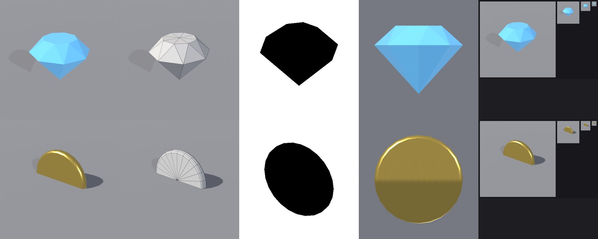
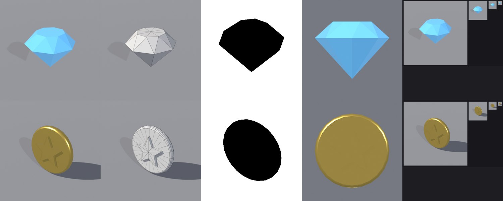
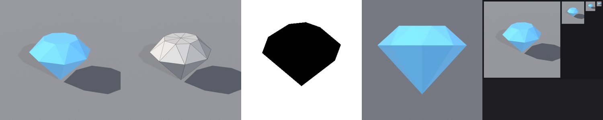

# BL-EX-02 — Collectibles: gem and coin

## Acceptance criteria
Readable at 64 px; pivot at the **centre** (they spin and bob in place); gem ≤ 200 tris.

## v1

- **Gem**: a classic brilliant silhouette, 32 tris, reads at 32 px. **Passed; unchanged later.**
- **Coin, real defect 1 (presentation):** with a centre pivot, the ground plane cut the coin in half in the inspection renders. The renders hid half the asset.
- **Coin, real defect 2 (design):** a blank disc reads as a plain yellow dot at 64/32 px.

## v2
- The harness lifts non-base-pivot assets above the ground for inspection renders only ([BL-11](../BL-11-Lighting-and-Rendering.md)).
- Coin: a raised five-point star emboss, in the same mesh and material (328 tris).
- **New defect found by QC:** the gem's pivot was **1.5 studs** off-centre. `center_on_origin` read `matrix_world` right after changing `.location`, before Blender updated it, so it centred on stale data. Fixed with `view_layer.update()` ([FC-BL-06](../../15-Anti-Patterns-and-Failure-Cases/Failures/FC-BL-06-Stale-Matrix-World.md)).

## v3 (gem pivot re-check)

Gem QC: 0 FAIL, 0 WARN; pivot at the centre ([gem v3 QC](../../Assets/Original/Blender/BL-EX-02-Collectible-Gem-and-Coin/gem-v3-qc.json)).

## Result
| | Result |
|---|---|
| Gem | **Pass**: 32 tris, pivot centred (v3), reads at 32 px. [FBX](../../Assets/Original/Blender/BL-EX-02-Collectible-Gem-and-Coin/export/gem_v3.fbx) · [GLB](../../Assets/Original/Blender/BL-EX-02-Collectible-Gem-and-Coin/export/gem_v3.glb) |
| Coin | **Pass with notes**: the star reads at 3/4 view, but with one gold material the emboss is low-contrast in front view and invisible at 64 px. The silhouette (a circle) still reads as "coin". Next step: darker recessed star via a palette texture ([BL-EX-07](BL-EX-07-Palette-Single-Material.md)). [FBX](../../Assets/Original/Blender/BL-EX-02-Collectible-Gem-and-Coin/export/coin_v2.fbx) · [GLB](../../Assets/Original/Blender/BL-EX-02-Collectible-Gem-and-Coin/export/coin_v2.glb) · [coin v1 QC](../../Assets/Original/Blender/BL-EX-02-Collectible-Gem-and-Coin/coin-v1-qc.json) · [coin v2 QC](../../Assets/Original/Blender/BL-EX-02-Collectible-Gem-and-Coin/coin-v2-qc.json) · [gem v1 QC](../../Assets/Original/Blender/BL-EX-02-Collectible-Gem-and-Coin/gem-v1-qc.json) · [gem v2 QC](../../Assets/Original/Blender/BL-EX-02-Collectible-Gem-and-Coin/gem-v2-qc.json) |

## Lessons
- **Same-material emboss relies on lighting.** For small on-screen sizes, use colour/value contrast, not geometry alone.
- Pickups read through **silhouette + colour + motion** (spin/bob, sparkle). Model for the silhouette, and let the VFX recipe do the rest ([R03 Currency Collection](../../18-Skill-Training/Design-Recipes/R03-Currency-Collection-Interaction.md)).
- Turn on pivot checks for single-mesh assets. The pivot bug existed in v1 too but was not checked until v2.
