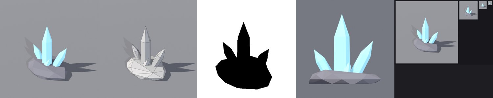
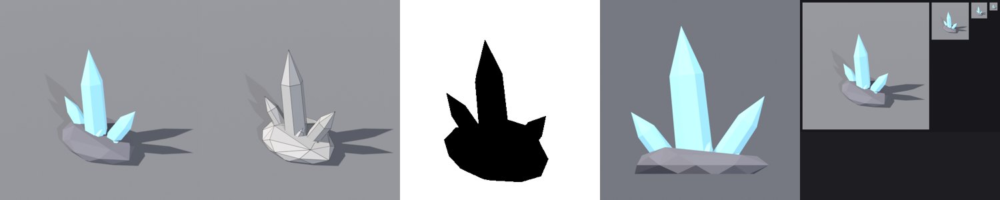

# BL-EX-03 — Crystal cluster

## Acceptance criteria
A spiky radial silhouette that cannot be mistaken for a rock; ≤ 600 tris; base and shards each one material.

## v1

- Silhouette reads as crystal immediately. 180 tris.
- **QC FAIL:** the hexagonal base of each shard was a 6-sided n-gon (5 found) ([v1 QC](../../Assets/Original/Blender/BL-EX-03-Crystal-Cluster/crystal_cluster-v1-qc.json)).
- Mild: the side shards are similar in size, and the prisms read a little like pencils.

## v2
Base faces fanned to triangles; stronger size hierarchy (one hero shard 2.6 tall, two mids, three small accents) and a wider fan of tilts.

- 214 tris; **QC: 0 FAIL, 0 WARN** ([v2 QC](../../Assets/Original/Blender/BL-EX-03-Crystal-Cluster/crystal_cluster-v2-qc.json)). [FBX](../../Assets/Original/Blender/BL-EX-03-Crystal-Cluster/export/crystal_cluster_v2.fbx) · [GLB](../../Assets/Original/Blender/BL-EX-03-Crystal-Cluster/export/crystal_cluster_v2.glb)

## Result
**Pass.** Triangles and points = "crystal/danger/value" at a glance ([BL-02](../BL-02-Shape-Language-Silhouette-Proportion.md)).

## Lesson
Size hierarchy (hero / mid / accent) is what makes clusters look designed rather than scattered.
