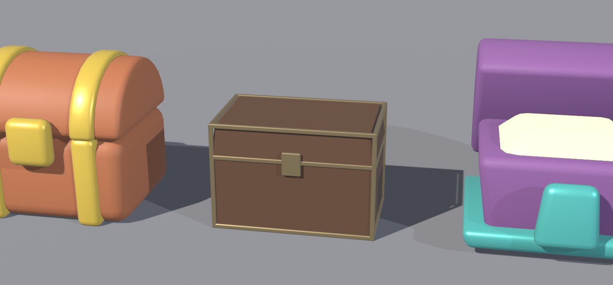
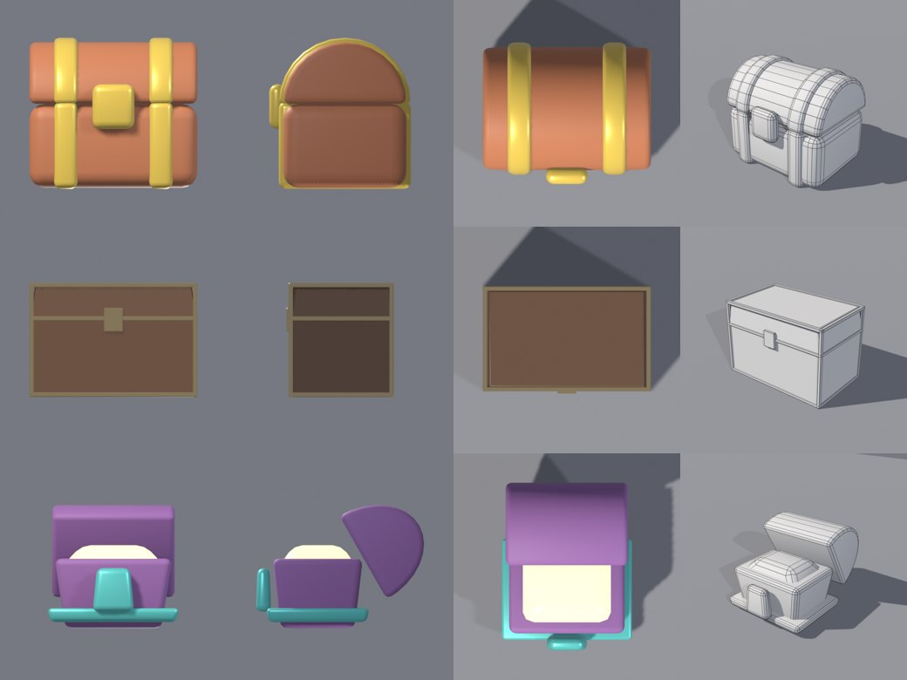
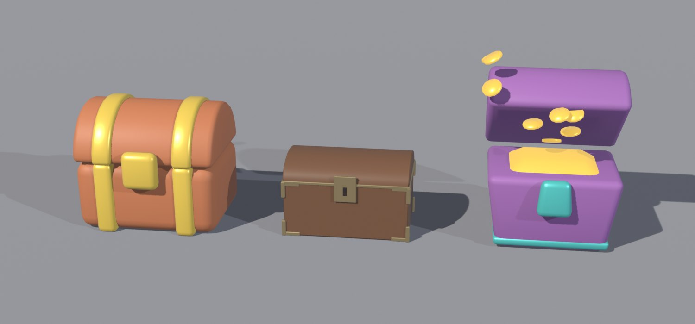
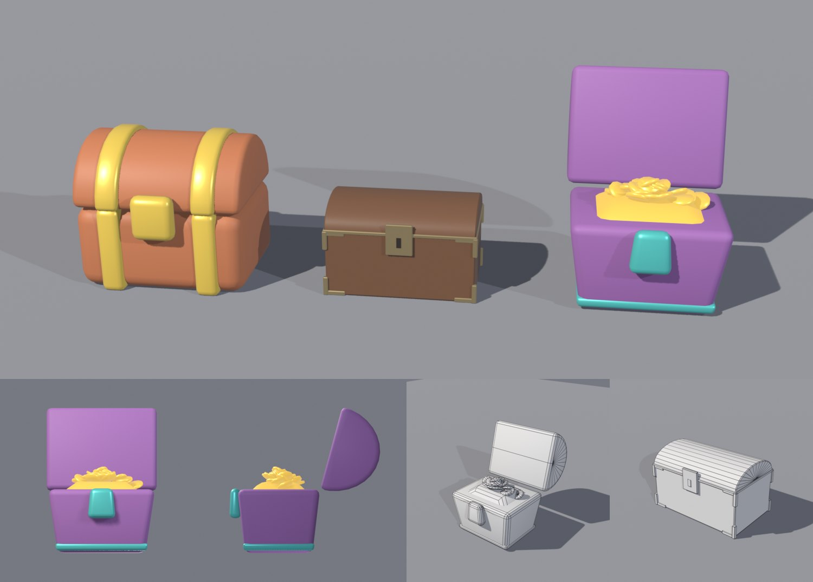
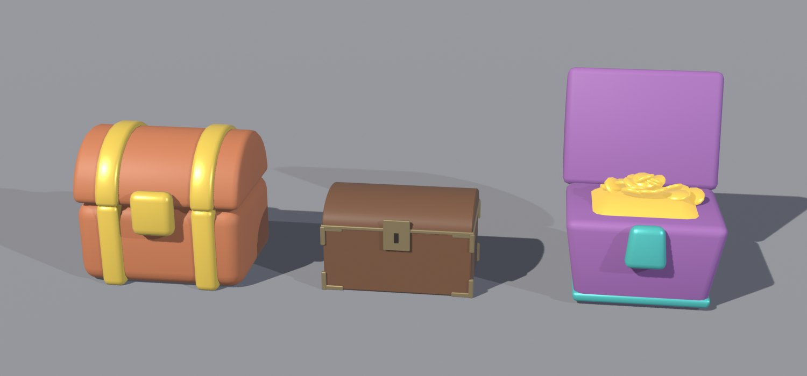
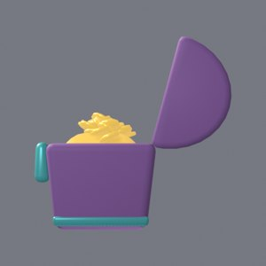
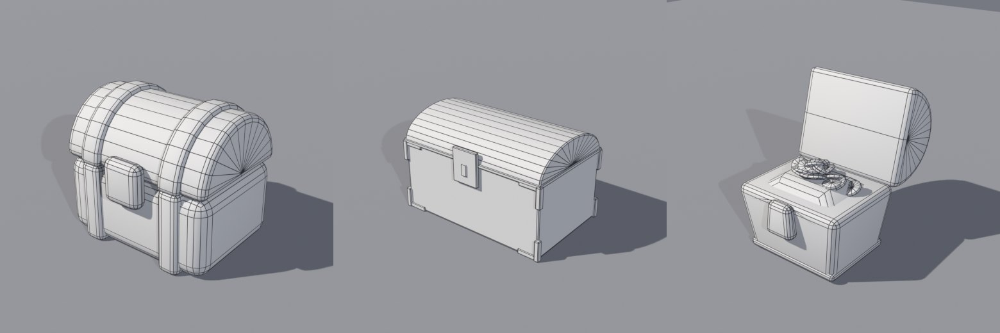
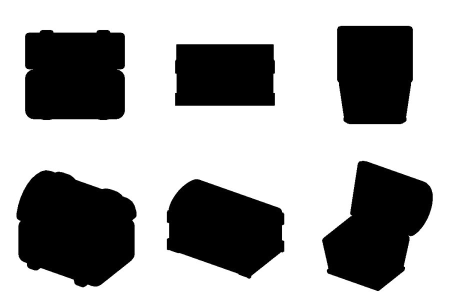
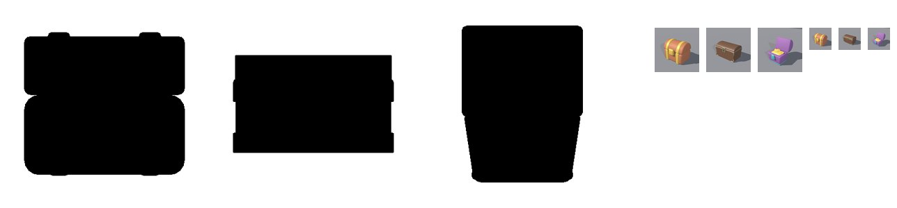

# BL-EX-04 — Treasure chest in three art directions

**Status: executed** in Blender 5.2.3 (bpy, headless, EEVEE software rendering), 2026-10-24. Four iterations. All images below are real renders from this session.

## Task
Build one treasure chest in three directions: **chunky toy**, **premium restrained**, **exaggerated cartoon**. Compare silhouette, readability, detail, production cost and fit for different game identities.

## Acceptance criteria (written before building)
- **A1** Each chest reads as a treasure chest from its silhouette alone.
- **A2** The three directions are distinguishable at 64 px.
- **A3** Every mesh passes all rbx_qc FAIL checks (≤20k tris, watertight, no n-gons, ≤1 material, volume).
- **A4** Assembly pivot at bottom-centre (0,0,0); width about 2–3.5 studs (fits a 5-stud avatar).
- **A5** FBX and GLB export and re-import with the same dimensions (Blender-side).

## Iteration log (self-critique loop)
### v1

**Defects found, ranked by impact:**
1. **Cartoon: the lid floats free of the body, and the front view reads as a sofa.** The side view shows a detached half-disc lid. *Impact: the identity fails.*
2. **Premium: a plain rectangle in front and side views; it reads as a crate.** *Impact: identity fails (A1).*
3. **Cartoon: the treasure renders as a blown-out white slab** (emission 4.0 with no form).
4. **QC FAIL:** n-gons on the half-cylinder lid caps (toy, cartoon); one zero-area face (cartoon metal). See [qc-report-v1.json](../../Assets/Original/Blender/BL-EX-04-Treasure-Chests/qc-report-v1.json).
5. Cartoon base band reads as a tray.
6. The line-up camera crops the outer chests (presentation).

### v2: fixes for 1–6
- Premium: **arched lid** (half-cylinder, squash 0.55), L-shaped **corner brackets** instead of a thin uniform frame, larger lock plate plus keyhole.
- Cartoon: lid hinged on the back edge, 40° open; treasure as a **heap of 22 coin discs**, emission 0.6; thin flush band.
- Lid caps changed to **triangle fans**.

**v2 result:** the premium chest now reads as a treasure chest. **New defects:**
- **The n-gon fix created non-manifold T-junctions.** The fan centre vertex lay on the bottom edge, but the bottom quad did not use it, so QC FAILed "watertight" on every lid ([FC-BL-03](../../15-Anti-Patterns-and-Failure-Cases/Failures/FC-BL-03-Ngon-Fix-Created-T-Junction.md)). Fixed by splitting the bottom into two quads.
- Coin caps (from `create_cone`) were n-gons; fixed with `cap_tris=True`.
- **Coins flung high above the chest:** each coin was rotated via `rotation_euler` and applied around the **world origin**, because builder objects have their origin at (0,0,0) ([FC-BL-04](../../15-Anti-Patterns-and-Failure-Cases/Failures/FC-BL-04-Rotation-Around-World-Origin.md)).
- At 40° the lid showed its flat underside and still read as a floating slab.

### v3
Coins tilted in mesh space around their own centre; lid opened to 105° (leaning back); the pivot measured on the body footprint (the open lid overhangs).

**v3 result:** the cartoon chest reads as an open treasure chest. The side view still showed a **gap at the hinge**: exact edge contact plus bevels leaves a visible seam ([FC-BL-05](../../15-Anti-Patterns-and-Failure-Cases/Failures/FC-BL-05-Exact-Contact-Leaves-Gap.md)).

### v4 (final)
Hinge tucked 0.12 studs into the body. Silhouette tests added (front **and** gameplay angle).

**Silhouette test (top row: front orthographic; bottom row: elevated 3/4 gameplay camera)**

**Small-size test (64 px and 32 px)**

## Results against the acceptance criteria (v4)
| Criterion | Result | Evidence |
|---|---|---|
| A1 silhouette | **Pass at the gameplay angle; Fail in front orthographic view for premium and open cartoon.** The premium chest is a rectangle from the front, and the open cartoon chest reads as a bin/cup. | silhouette image |
| A2 64 px | **Pass**, distinct by colour and shape; at 32 px mostly by colour | small-size image |
| A3 QC | **Pass**: 0 FAIL, 0 WARN for all meshes. Tris: toy 1,620 · premium 1,060 · cartoon 1,856 | [qc-report-v4.json](../../Assets/Original/Blender/BL-EX-04-Treasure-Chests/qc-report-v4.json) |
| A4 pivot/size | **Pass**: body-footprint pivot offset 0.0 for all; widths 3.0 / 2.68 / 2.76 studs | qc-report-v4 `_summary` |
| A5 export | **Pass in Blender**: FBX and GLB re-import at identical dimensions (e.g. premium 2.67×1.705×1.815). **Studio import not tested.** | [roundtrip-v4.json](../../Assets/Original/Blender/BL-EX-04-Treasure-Chests/roundtrip-v4.json) |

Export files for a Studio test: toy [FBX](../../Assets/Original/Blender/BL-EX-04-Treasure-Chests/export/chest_toy.fbx) · [GLB](../../Assets/Original/Blender/BL-EX-04-Treasure-Chests/export/chest_toy.glb) — premium [FBX](../../Assets/Original/Blender/BL-EX-04-Treasure-Chests/export/chest_premium.fbx) · [GLB](../../Assets/Original/Blender/BL-EX-04-Treasure-Chests/export/chest_premium.glb) — cartoon [FBX](../../Assets/Original/Blender/BL-EX-04-Treasure-Chests/export/chest_cartoon.fbx) · [GLB](../../Assets/Original/Blender/BL-EX-04-Treasure-Chests/export/chest_cartoon.glb). QC history: [v1](../../Assets/Original/Blender/BL-EX-04-Treasure-Chests/qc-report-v1.json) · [v2](../../Assets/Original/Blender/BL-EX-04-Treasure-Chests/qc-report-v2.json) · [v3](../../Assets/Original/Blender/BL-EX-04-Treasure-Chests/qc-report-v3.json) · [v4](../../Assets/Original/Blender/BL-EX-04-Treasure-Chests/qc-report-v4.json).

## Comparison of the three directions
| | Toy | Premium | Cartoon |
|---|---|---|---|
| Silhouette | Strong from every angle (bands + dome) | Weak from the front, good at 3/4 | Strongest *personality*, state-dependent read |
| Readability at 64 px | Best (saturated warm + gold) | Lowest (dark, low contrast) | Good (purple/teal unusual on the chart) |
| Detail density | Low, large forms | Medium-high (brackets, keyhole) | Medium (coins) |
| Triangles | 1,620 (bevel segments dominate) | 1,060 | 1,856 (coins) |
| Production cost (this session) | 1 iteration | 3 iterations (identity fix) | 4 iterations (hinge, coins, lid angle) |
| Fits | Kids/casual simulators, bright obbies | RPG/adventure, collector UI, "luxury" pass items | Party/comedy games, loot moments needing excitement |
| Risks | Can look generic "mobile toy" | Disappears at small sizes and in dark scenes | Visual noise if every prop is this loud |

## Lessons (reusable)
1. **Judge silhouettes from the gameplay camera.** A front orthographic view is the worst case and over-penalizes some designs ([BL-02](../BL-02-Shape-Language-Silhouette-Proportion.md)).
2. **Re-run the full QC after every geometry fix.** Fixing n-gons created non-manifold edges.
3. **Rotate in mesh space** when builders place origins at the world origin.
4. **Overlap parts slightly** instead of exact contact.
5. **Identity comes from 2–3 features** (arched lid, bands/trim, lock). Removing one (the v1 premium flat lid) breaks the read faster than any amount of detail can fix.
6. Restraint costs readability at small sizes; give premium designs a high-contrast focal point (the brass lock plate).
