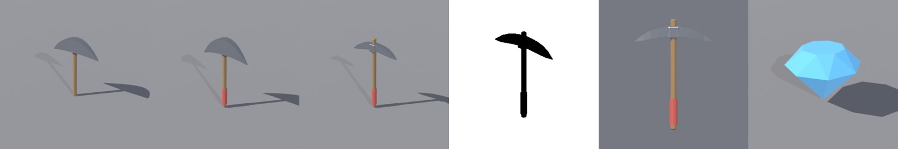

# BL-EX-05 — Pickaxe tool

## Acceptance criteria
The side silhouette reads as a pickaxe; origin at the **grip** (about 18% up the handle); about 4 studs long; the head contrasts with the handle.

## Iterations

- **v1** (288 tris): the head profile grows tall in the middle (a crescent cross-section). At 3/4 the head reads like an **umbrella canopy over a shaft**. Separately, the inspection render showed the lower handle darkened and cut by the ground, because the grip pivot puts part of the handle below z=0 (the same presentation bug as the coin). [v1 sheet](../../Assets/Original/Blender/BL-EX-05-Pickaxe-Tool/pickaxe-tool-v1-inspection.jpg)
- **v2** (320 tris): a thicker head plus a red grip wrap. **The umbrella read did not go away.** Thickness was not the problem; the crescent profile was. [v2 sheet](../../Assets/Original/Blender/BL-EX-05-Pickaxe-Tool/pickaxe-tool-v2-inspection.jpg)
- **v3** (320 tris): a near-constant-thickness bar with sharp tips, less sag, and the **handle poking through the top of the head** (the eye). The gameplay silhouette now reads unambiguously as a pick. [v3 sheet](../../Assets/Original/Blender/BL-EX-05-Pickaxe-Tool/pickaxe-tool-v3-inspection.jpg)

## Result (v3)
| Criterion | Result |
|---|---|
| Silhouette | **Pass** at the gameplay angle |
| Grip pivot | Pass (QC 0 FAIL/WARN, [v3 QC](../../Assets/Original/Blender/BL-EX-05-Pickaxe-Tool/pickaxe-v3-qc.json)) |
| Length | 3.75 studs |
| Contrast | **Pass with notes**: steel grey on a grey inspection background is low-contrast; in-game contrast depends on the environment |
Exports: [FBX](../../Assets/Original/Blender/BL-EX-05-Pickaxe-Tool/export/pickaxe_v3.fbx) · [GLB](../../Assets/Original/Blender/BL-EX-05-Pickaxe-Tool/export/pickaxe_v3.glb) · QC history: [v1](../../Assets/Original/Blender/BL-EX-05-Pickaxe-Tool/pickaxe-v1-qc.json) · [v2](../../Assets/Original/Blender/BL-EX-05-Pickaxe-Tool/pickaxe-v2-qc.json)

## Lessons
- **A failed fix is evidence about the cause.** v2 changed thickness and did not help, so the cause was the profile. Do not keep tweaking the same parameter.
- Functional details (where the handle meets the head) carry the "tool" read.
- For Roblox `Tool`s, put the origin at the grip; it simplifies Grip offsets. Not verified in Studio here.
