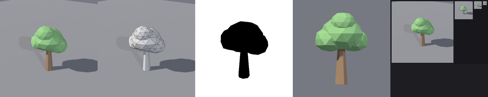

# BL-EX-06 — Stylized tree

## Acceptance criteria
Reads as a tree at 64 px; trunk and canopy as separate meshes (one material each); ≤ 1,500 tris total; pivot at the trunk base.

## Result

- 348 tris (7-sided tapered trunk + 4 noise-displaced icosphere blobs, flattened 0.8 on Z), 5.07 studs tall (taller than a classic avatar).
- Reads as a tree at 32 px; the gameplay silhouette is a lollipop-style tree. QC: 0 FAIL/WARN ([v1 QC](../../Assets/Original/Blender/BL-EX-06-Stylized-Tree/tree-v1-qc.json)).
- **Passed review; no changes made.** I had pre-written v2 tweaks "for the canopy" before seeing v1. They were **removed**, because v1 showed no defect that justified them. Critique must follow evidence. The v2 run is unchanged ([v2 sheet](../../Assets/Original/Blender/BL-EX-06-Stylized-Tree/stylized-tree-v2-inspection.jpg), [v2 QC](../../Assets/Original/Blender/BL-EX-06-Stylized-Tree/tree-v2-qc.json)).
- Exports: [FBX](../../Assets/Original/Blender/BL-EX-06-Stylized-Tree/export/tree_v2.fbx) · [GLB](../../Assets/Original/Blender/BL-EX-06-Stylized-Tree/export/tree_v2.glb)

## Known limitations
- A generic "lollipop" tree style. Fine for casual games; a distinctive art direction would push trunk curvature and canopy shape language.
- For foliage made of planar cards (as in Roblox's environment-art sample), use `MeshPart.DoubleSided` (the docs note it costs a second render pass).
