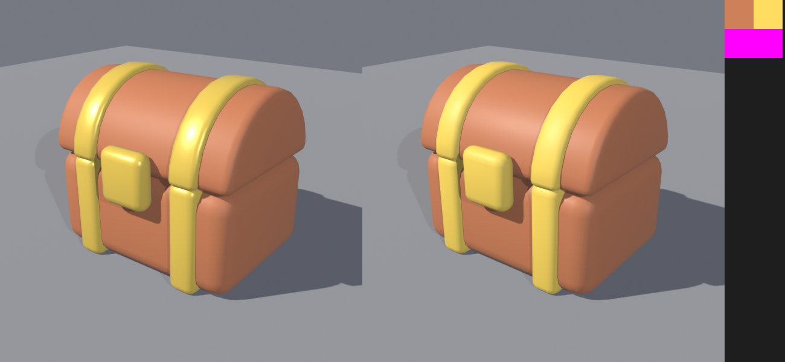

# BL-EX-07 — Palette texture conversion

## Why
Roblox allows **one material per mesh**. Multi-colour stylized props either stay split into several MeshParts (more objects) or use a **palette texture**: a tiny image of swatches, with each face's UVs placed inside one swatch.

## Acceptance criteria (set before building)
The toy chest (3 meshes, 3 flat materials) becomes **one** mesh, **one** material, **one** UV set, with UVs in 0–1. Colours preserved: mean render difference vs the original under 3/255 per channel inside the object. FBX/GLB export and re-import with the texture.

## Method (`palette_convert`)
1. Collect the materials; write each Base Color into an 8×8 px swatch, converting **linear → sRGB**, because Principled Base Color is linear and PNG pixels are sRGB.
2. For every face, set all loop UVs to its material's swatch centre.
3. Join the meshes; replace the materials with one material whose Image Texture (interpolation **Closest**, so swatches don't bleed) feeds Base Color.

## Result

| Check | Result |
|---|---|
| Meshes / materials / UV sets | 1 / 1 / 1; UVs inside 0–1 |
| Colour preservation | mean |Δ| per channel **1.82 / 1.87 / 1.40** (out of 255) over 302,144 object pixels: **Pass** (< 3) |
| Worst differences | p99 = 18: the gold trim **lost its metallic highlight**. One material means one roughness/metallic for every part |
| Triangles | 1,620 (unchanged) |
| QC | 0 FAIL; 1 WARN: pivot 0.087 from the bounding-box centre, because the bands and lock protrude forward. The pivot is correct on the body (by design) |
| Export | FBX (44 KB) and GLB (38 KB) re-import at 3.0×2.53×2.7; the GLB re-import contains the `ex07_palette` image |
Files: [palette PNG](../../Assets/Original/Blender/BL-EX-07-Palette-Single-Material/toy-chest-palette.png) · [results JSON](../../Assets/Original/Blender/BL-EX-07-Palette-Single-Material/palette-results.json) · [FBX](../../Assets/Original/Blender/BL-EX-07-Palette-Single-Material/export/toy_chest_palette.fbx) · [GLB](../../Assets/Original/Blender/BL-EX-07-Palette-Single-Material/export/toy_chest_palette.glb)

## Trade-offs
| Split meshes (one per material) | Palette texture |
|---|---|
| Per-part roughness/metal | One surface response for everything |
| More MeshParts (more objects) | One MeshPart |
| No texture memory | A tiny texture (16×16 here) |
| Each part tintable with `MeshPart.Color` | Tinting affects everything (use `SurfaceAppearance` TintMask for regions) |
Use the palette for **small, numerous props** (fewer objects); keep splits where **material response** matters (metal shine on a hero chest).

## Not verified
Studio import of the palette FBX/GLB (whether the texture appears exactly as in Blender).
