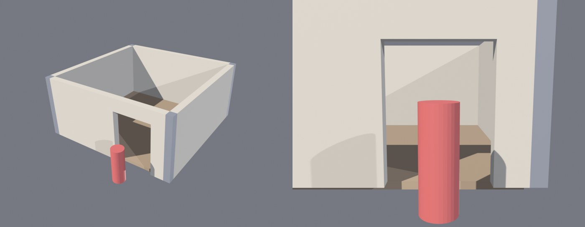

# BL-EX-09 — Modular building kit

## Grounding (Roblox environmental-art curriculum)
- Kit pieces snap in **5-stud increments** with a consistent pivot location; each kit asset is at least 5 studs tall and wide (develop-polished-assets).
- Doorways and halls at least **10 studs wide**, walls at least **10 studs tall**: two players can pass, nobody jumps a wall with the default **5-stud jump**, and the camera has room (greybox-your-environment).

## Acceptance criteria
- **K1** Pieces: wall 10×1×10, doorway wall 10×1×10 with a 6-wide × 8-tall opening, floor 10×10×0.5, 1×1×10 corner post.
- **K2** Pivot at the front-left-bottom corner; *(revised in v2)* length and height on the 5-stud grid.
- **K3** A 20×20 room assembled from copies only (90° rotations): no gaps at the seams.
- **K4** Every piece passes rbx_qc FAILs; the door opening fits an avatar.

## v1: what went wrong ([v1 report](../../Assets/Original/Blender/BL-EX-09-Modular-Building-Kit/kit-report-v1.json))
1. **Doorway QC FAIL (non-manifold):** built as three joined boxes (two jambs + lintel), whose touching internal faces break watertightness.
2. **K2 failed for walls and the doorway, but the criterion was wrong.** I had required *every* footprint edge on the 5-grid, which a 1-stud-thick wall can never meet. The curriculum snaps positions and length/height; corner posts absorb the thickness.
3. **The seam check reported a gap at y = 10.0 on the east wall.** A probe showed hits at 9.999 and 10.001 and a miss only at exactly 10.0: the ray slipped between two coincident pieces at their shared edge. **This was a measurement artifact, not a gap.**
4. An earlier draft of the check used **bounding boxes**, which would have hidden the door opening, because a joined doorway's bounding box spans the hole. It was replaced with ray casts before the first run.

## v2: fixes
- Doorway = **one U-shaped profile extruded 1 stud**, with the n-gon caps triangulated (BEAUTY): watertight, 28 tris.
- K2 restated (pivot + length/height on the grid).
- Seam samples offset by 0.25 studs.

## Result (v2)

| Criterion | Result |
|---|---|
| K1 sizes | Pass (wall 10×1×10, doorway 10×1×10, floor 10×10×0.5, corner 1×1×10) |
| K2 grid/pivot | Pass (revised criterion) |
| K3 seams | **Pass**: 0 unexpected gaps; the door opening is detected as 12 samples = 6 studs |
| K4 QC / avatar | Pass: 0 FAIL on all pieces; 8-stud opening vs 5-stud reference avatar |
| Instancing | The room is **16 objects using 4 unique meshes** (shared mesh data), i.e. 4 asset ids in Studio ([LU-26](../../07-Roblox-Studio-and-Luau/LU-26-Asset-Import-and-Organization.md)) |
Report: [kit-report-v2.json](../../Assets/Original/Blender/BL-EX-09-Modular-Building-Kit/kit-report-v2.json) · Exports: [wall](../../Assets/Original/Blender/BL-EX-09-Modular-Building-Kit/export/kit_wall.fbx) · [doorway](../../Assets/Original/Blender/BL-EX-09-Modular-Building-Kit/export/kit_doorway.fbx) · [floor](../../Assets/Original/Blender/BL-EX-09-Modular-Building-Kit/export/kit_floor.fbx) · [corner](../../Assets/Original/Blender/BL-EX-09-Modular-Building-Kit/export/kit_corner.fbx)

## Lessons
- **Build openings as one profile, not joined boxes.** Joining touching solids creates internal faces.
- **Validate your validator:** both checks I wrote (bounding-box coverage, exact-seam rays) had blind spots that would have produced false results.
- When a criterion fails, check whether the **criterion** is wrong before "fixing" the asset. Then say openly that it was revised.

## Not done
Trim pieces, windows, stairs; texturing with a trim sheet; importing into Studio and snapping with grid snap at 5 studs.
