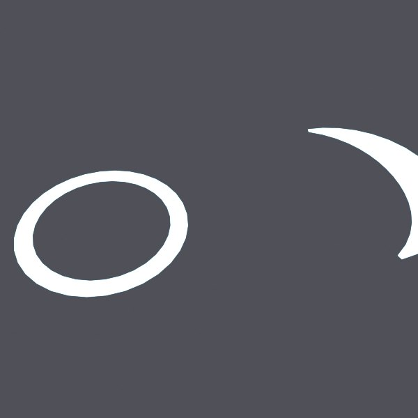
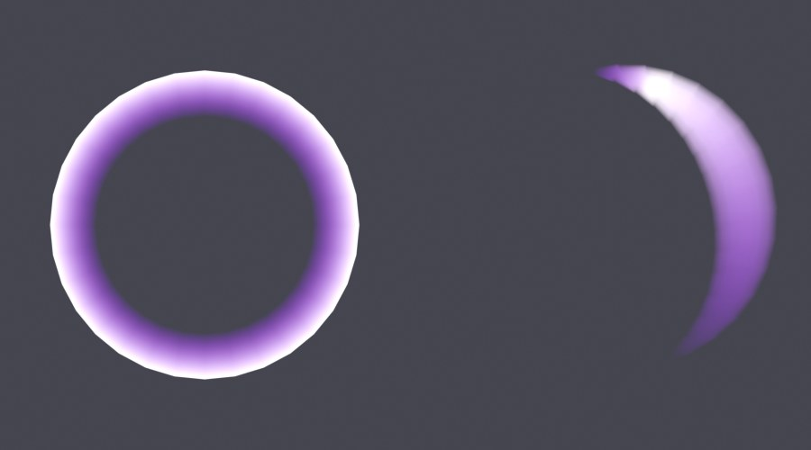

# BL-EX-12 — VFX geometry

## Why
Many game effects (shockwaves, slashes, auras) are simple meshes whose **UVs drive a gradient texture**, so one texture fades the effect along its length. The mesh is then scaled, rotated or faded in code (TweenService) or with flipbooks.

## Acceptance criteria
Ring and slash cards with UVs running 0→1 along the effect, so a gradient fades them; ≤ 200 tris each. Open/planar by design: watertight and volume checks do not apply (documented).

## v1

**Failed as evidence:** emission 3.0 with no texture rendered both meshes as flat white shapes. The UV gradient, which was the point of the exercise, was invisible, and the slash was cropped. QC also showed **a limitation in my own tool**: on open cards, the "faces pointing inward" heuristic misfired (16 and 32 false WARNs), and watertight/volume FAILs were reported for meshes that are meant to be open.

## v2
- A generated gradient PNG ([vfx-gradient.png](../../Assets/Original/Blender/BL-EX-12-VFX-Geometry/vfx-gradient.png)) drives base colour, emission **and alpha** through the UVs; emission lowered to 1.2; orthographic framing of both meshes.
- QC gained `card=True`: open-mesh checks become INFO, and the inward-normal heuristic is skipped on non-manifold meshes.

- Ring fades from the inner edge to a bright outer edge; slash fades tail → head with a soft tip. 96 tris total. QC (card mode): 0 FAIL, 0 WARN ([QC](../../Assets/Original/Blender/BL-EX-12-VFX-Geometry/vfx-v2-qc.json)).
- Exports: [shockwave FBX](../../Assets/Original/Blender/BL-EX-12-VFX-Geometry/export/vfx_shockwave.fbx) · [slash FBX](../../Assets/Original/Blender/BL-EX-12-VFX-Geometry/export/vfx_slash.fbx)

## Notes
- **Remaining defect:** the gradient's low-alpha colour is saturated purple. Where alpha blending is partial, a purple fringe shows on the inner ring edge. For additive-looking effects, make the low end of the ramp dark as well as transparent.
- Roblox side (not verified here): import as MeshParts, apply the gradient as a texture with transparency, `CanCollide/CanQuery/CanTouch = false`, `CastShadow = false`, and consider `DoubleSided` for cards seen from both sides (per the environment-art docs it renders twice).
- Planar meshes contradict the general "watertight + volume" mesh spec, but Roblox's own environment-art curriculum uses planar cards for foliage. Treat the spec as the default for solid props, and cards as a documented exception.
