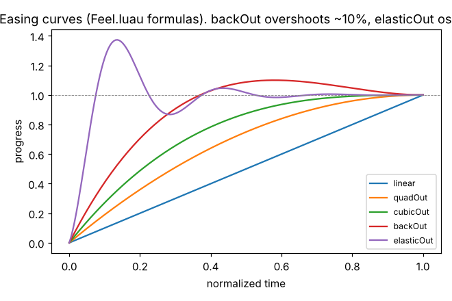
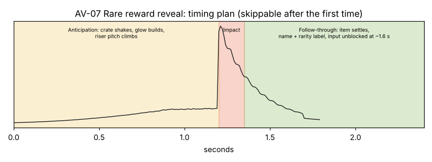

# Animation, VFX and Sound Recipe Book

23 recipes in one template: trigger, timing, anticipation, main action, impact, follow-through, sound, visual hierarchy, performance, **when restraint is better**, Roblox implementation, evidence.

**Evidence:** timings marked "measured" come from official Roblox videos ([Timing Reference](../Timing-Reference.md)). Other values are starting points to tune by playtest. **Previews** (sounds, GIFs, timing diagrams) were generated in this session ([`_tools/av/make_av_previews.py`](../../_tools/av/make_av_previews.py)). The sounds are original synthesized placeholders, **measured but not listened to**, since the generating agent cannot hear.

## Generated previews (real outputs)

| Preview | Measured |
|---|---|
| Button press GIF (60 fps) | min scale 0.940, max 1.006 (Back Out overshoot) |
| Coin burst GIF v1 → v2 | v1 failed (clumped, rose 20–40 px); v2 100° spread, faster launch, reads as a burst |
| Sounds (10) | button 70 ms; coin streak onsets every 110 ms; purchase 0.47 s; error 160 ms @ ≈300 Hz centroid; level-up 0.9 s; rare reveal impact onset 1.200 s; light hit 90 ms; heavy hit 0.43 s → **0.35 s after fix**; victory 0.9 s → **1.46 s after fix**; defeat 1.95 s |

Measurements: [final](../../Assets/Original/AV/av-measurements-final.json) · [v1](../../Assets/Original/AV/av-measurements-v1.json)

## Recipes
| # | Recipe |
|---|---|
| AV-01 | [Button feedback](AV-01-Button-Feedback.md) |
| AV-02 | [Menu and panel transitions](AV-02-Menu-Transitions.md) |
| AV-03 | [Collecting (coins, gems, pickups)](AV-03-Collecting.md) |
| AV-04 | [Upgrade purchase](AV-04-Upgrade-Purchase.md) |
| AV-05 | [Error / denied action](AV-05-Error-Denied.md) |
| AV-06 | [Level-up and milestones](AV-06-Level-Up.md) |
| AV-07 | [Rare reward reveal](AV-07-Rare-Reward-Reveal.md) |
| AV-08 | [Impact (light and heavy hits)](AV-08-Impact.md) |
| AV-09 | [Explosion](AV-09-Explosion.md) |
| AV-10 | [Movement feedback (dash, jump, landing)](AV-10-Movement-Feedback.md) |
| AV-11 | [Progress feedback (bars, counters)](AV-11-Progress-Feedback.md) |
| AV-12 | [Environmental effects (ambient life)](AV-12-Environmental-Effects.md) |
| AV-13 | [Victory](AV-13-Victory.md) |
| AV-14 | [Defeat](AV-14-Defeat.md) |
| AV-15 | [Cutscenes and scene transitions](AV-15-Cutscene-and-Transitions.md) |
| AV-16 | [Sound layering](AV-16-Sound-Layering.md) |
| AV-17 | [Audio transitions (music states, crossfades, ducking)](AV-17-Audio-Transitions.md) |
| AV-18 | [Controlling repetition fatigue](AV-18-Repetition-Fatigue.md) |
| AV-19 | [Camera movement (shake, kick, follow)](AV-19-Camera-Movement.md) |
| AV-20 | [Particle system setup and budget](AV-20-Particle-System-Setup.md) |
| AV-21 | [Damage taken and low health](AV-21-Damage-and-Low-Health.md) |
| AV-22 | [Hazard telegraph and warnings](AV-22-Hazard-Telegraph.md) |
| AV-23 | [Performance-aware effects (quality tiers)](AV-23-Performance-Aware-Effects.md) |

Related: [Design Recipes R01–R15](../../18-Skill-Training/Design-Recipes/R01-Polished-Main-Menu.md) · [Feedback Arc and Impact](../Feedback-Arc-and-Impact.md) · [CL-03 Animation and VFX Review](../../23-Quality-Checklists/CL-03-Animation-and-VFX-Review.md) · [CL-05 Audio Review](../../23-Quality-Checklists/CL-05-Audio-Review.md)
