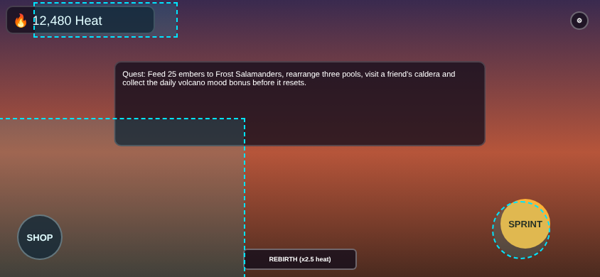
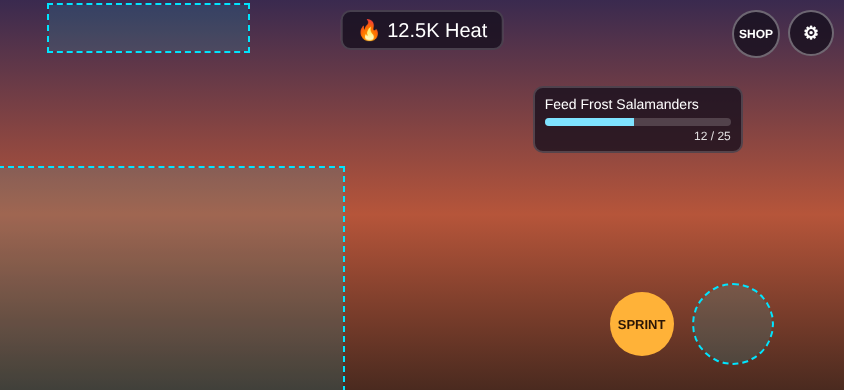

# BM-03 — Fix a cluttered mobile HUD

| Field | Value |
|---|---|
| Area | UI/UX |
| Level | Intermediate |
| Time box | 60 min |
| Status | ✅ Executed by the academy |

## Task
`_tools/ui/bm03_before.html` is a HUD with hierarchy and mobile problems. Produce a fixed version that passes `bm03_check.js` at phone and tablet sizes, and explain each change in terms of hierarchy, reach and reserved zones.

## Inputs
- `bm03_before.html`, `hud_common.css`.
- `bm03_check.js` (Playwright): reserved zones measured approximately from Roblox's *Touch-Reserved-Zones* illustration, plus house rules: font ≥ 12 px, tap targets ≥ 44 px, info panels ≤ 15% of the screen, primary action within 0.35 × screen height of the jump button, no overlaps.

## Deliverables
- `bm03_after.html`.
- Checker output for both viewports.
- A change list (element → problem → change → reason).

## Acceptance criteria (pass/fail)
- [ ] 0 checker issues at 844×390 and 1024×768.
- [ ] The primary action is placed relative to the jump button.
- [ ] Rarely used actions are moved off the HUD or into a corner cluster.
- [ ] A visual review of the screenshots is written (the checker is not the whole judgement).

## Scoring rubric (0 / 1–2 / 3)
| Dimension | 0 | 1–2 | 3 |
|---|---|---|---|
| Hierarchy | Same as before | Some reprioritising | Clear primary/secondary/tertiary |
| Mobile fit | Issues remain | Phone OK | Phone and tablet OK |
| Reasoning | Changes unexplained | Partial | Every change tied to a rule |

## Common failure modes
- Shrinking everything to make it fit.
- Trusting the checker without looking at the screenshots.
- Placing buttons at fixed top-percentages that are unreachable on tablets.

## Self-critique before submitting
Run the [Self-Critique Loop](../18-Skill-Training/Self-Critique-Loop.md): state the criteria **before** looking at the result, inspect the output (not your intention), and log every failed version.

## Academy run and evidence
Before: 11 issues on the phone, 8 on the tablet (currency under the Roblox top-left buttons, shop, quest and rebirth in the thumbstick zone, sprint on the jump button, 9 px text, 26 px tap targets, info panels covering 21.6%). After v1: 0 issues; **but visual review** found that quest progress showed only as small "12 / 25" text and that the checker never tested elements against each other. v2 added a progress bar and an element-overlap check: 0 issues, info area 6.3% (phone) and 2.6% (tablet). Measurements: [bm03_results.json](../Assets/Original/UI/BM-03/bm03_results.json). Cyan dashed areas = reserved zones as measured.

*Before, 844×390: 11 issues.*

*After v2, 844×390: 0 issues.*

Tablet: [before](../Assets/Original/UI/BM-03/bm03_before_tablet-landscape-1024x768.png) · [after v2](../Assets/Original/UI/BM-03/bm03_after_tablet-landscape-1024x768.png).

 **Limits:** the zones are eyeballed from one phone illustration and scaled by percentage to the tablet, where the real controls are probably fixed-size. HTML is not Roblox UI, so this trains layout judgement, not Studio implementation.

## Related
- [TUT-11 UI hierarchy](../16-Tutorials-and-Workflows/TUT-11-UI-Visual-Hierarchy-and-Wireframes.md)
- [CL-07 Mobile and Accessibility](../23-Quality-Checklists/CL-07-Mobile-and-Accessibility.md)
- [R13 Readable Mobile Interface](../18-Skill-Training/Design-Recipes/R13-Readable-Mobile-Interface.md)
